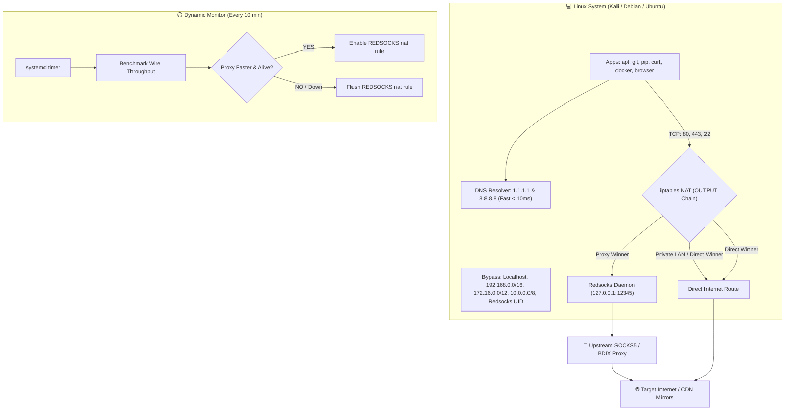

<div align="center">

# ⚡ Dynamic Proxy Router & BDIX Auto-Switch

**A smart, zero-touch transparent proxy router with dynamic failover and speed benchmarks for Kali Linux, Debian, and Ubuntu.**

[](#)
[](#)
[](#)
[](#)
[](#)

<p align="center">
  <a href="#-features">Features</a> •
  <a href="#-architecture">Architecture</a> •
  <a href="#-quick-start">Quick Start</a> •
  <a href="#-cli-commands">Commands</a> •
  <a href="#-verification">Verification</a> •
  <a href="#-troubleshooting">Troubleshooting</a> •
  <a href="#-uninstallation">Uninstall</a>
</p>

</div>

---

## 💡 Why This Tool?

When using high-speed **BDIX** or **SOCKS5/HTTP proxies**, traditional tools like `proxychains4` require manual command wrapping (`proxychains git clone ...`), break dynamically linked binaries, fail silently with tools like Docker and Go, and leave you disconnected whenever your proxy goes down.

**Dynamic Proxy Router** solves this completely:
- 🚀 **Transparent Kernel Redirection**: Intercepts outbound TCP traffic at the `iptables` layer and routes it through `redsocks`.
- ⚡ **Zero Command Prefixing**: Run `apt`, `git`, `curl`, `pip`, `docker`, and browsers normally without typing `proxychains`.
- ⏱️ **Automatic Speed Benchmarking**: Tests sustained wire speed every 10 minutes against BDIX & CDN endpoints.
- 🛡️ **Instant Failover**: If your proxy slows down, drops, or loses authentication, your connection instantly falls back to direct internet.
- 🌐 **Optimized DNS**: Automatically cleans `/etc/resolv.conf` and sets ultra-fast Cloudflare (`1.1.1.1`) and Google (`8.8.8.8`) nameservers.
- 🔒 **LAN & Docker Safe**: Automatically bypasses RFC 1918 / RFC 6598 private subnets (`10.0.0.0/8`, `172.16.0.0/12`, `192.168.0.0/16`, Docker bridges, Tailscale).

---

## 📊 Feature Comparison

| Feature | Standard `proxychains4` | Manual Redsocks | ⚡ Dynamic Proxy Router (v2.3) |
| :--- | :---: | :---: | :---: |
| **Command Prefixing** | ❌ Required every time | ✅ Automatic | ✅ **100% Zero-Touch** |
| **Supported Tools** | ⚠️ Partial (breaks statically linked) | ✅ All TCP tools | ✅ **Every tool (`apt`, `git`, `docker`, etc.)** |
| **Failover on Drop** | ❌ Connection hangs / aborts | ❌ Total blackout | ✅ **Seamless instant fallback to direct** |
| **Speed Optimization** | ❌ None | ❌ Manual | ✅ **Benchmarks & picks fastest route** |
| **DNS Optimization** | ⚠️ Can leak or stall | ❌ Unmanaged | ✅ **Auto-configured (`1.1.1.1`, `8.8.8.8`)** |
| **Local LAN / Docker** | ⚠️ Often intercepted | ⚠️ Requires manual rules | ✅ **Automatic RFC 1918 bypass** |
| **Authentication** | ⚠️ Config file editing | ⚠️ Manual config | ✅ **Interactive wizard & CLI flags** |

---

## 🏗️ Architecture



---

## 🚀 Quick Start

### 1. Clone the Repository

```bash
git clone https://github.com/your-username/auto-switch-fast-proxy.git
cd auto-switch-fast-proxy
chmod +x setup_dynamic_proxy.sh
```

### 2. Run Setup

Choose any of the following 3 ways to configure:

#### Option A: Interactive Wizard (Recommended)
Simply launch the setup script. It will detect your settings and ask for your proxy IP, port, and credentials:

```bash
sudo bash ./setup_dynamic_proxy.sh
```

```text
==================================================
⚡ Redsocks Proxy Configuration
==================================================
Options:
  1) Enter / update IP, Port, Username & Password (Recommended)
  2) Open /etc/redsocks.conf in nano to edit manually
  3) Keep current settings as-is
Select option [1/2/3] (default: 1): 1

Enter Proxy IP or Host [114.130.99.148]: 114.130.99.148
Enter Proxy Port [9169]: 9169
Enter Proxy Username (leave blank if none): myuser
Enter Proxy Password (leave blank if none): mypass
Enter Proxy Type (socks5/socks4/http-connect) [socks5]: socks5
```

#### Option B: Automated One-Liner (CLI Flags)
Set up everything in a single command:

```bash
# SOCKS5 proxy with authentication:
sudo bash ./setup_dynamic_proxy.sh --ip 114.130.99.148 --port 9169 --user myuser --pass mypass

# Anonymous proxy:
sudo bash ./setup_dynamic_proxy.sh --ip 103.150.100.5 --port 1080
```

#### Option C: Manual Editing (`nano`)
If you prefer editing `/etc/redsocks.conf` directly:
```bash
sudo nano /etc/redsocks.conf
```
Then run the setup script to validate and start the router:
```bash
sudo bash ./setup_dynamic_proxy.sh
```

---

## 🛠️ CLI Commands & Management

The script includes built-in controls for monitoring, benchmarking, and routing:

```bash
# Check current active route, redsocks status, and last benchmark
sudo bash ./setup_dynamic_proxy.sh --status

# Run an immediate speed benchmark test
sudo bash ./setup_dynamic_proxy.sh --test

# Force proxy mode ON immediately (override benchmark)
sudo bash ./setup_dynamic_proxy.sh --force-proxy

# Force direct mode ON immediately (bypass proxy)
sudo bash ./setup_dynamic_proxy.sh --force-direct

# View real-time background logs
tail -f /var/log/network_speed_monitor.log
```

---

## 🔍 Verification

Once installed, use standard commands **without** `proxychains4`:

### 1. Verify Public IP
```bash
# Shows proxy public IP if proxy is winning, or ISP IP if direct
curl https://ifconfig.me
```

### 2. Test High-Speed Download (apt & git)
```bash
# Test package manager through proxy:
sudo apt update

# Test git clone throughput:
git clone https://github.com/six2dez/reconftw.git /tmp/test-repo --depth=1
rm -rf /tmp/test-repo
```

### 3. Check Route Winner & Speed Logs
```bash
# View active winner:
cat /run/fastest_connection

# View latest benchmark entry:
tail -n 1 /var/log/network_speed_monitor.log
```
Example log output:
```text
[2026-10-10 13:00:22] Target: kali.download | Direct: 3.12 MiB/s | Proxy: 12.85 MiB/s | Winner: proxy
```

---

## ⚙️ Configuration File Reference

The router manages `/etc/redsocks.conf`. A standard working configuration looks like this:

```text
base {
    log_debug = off;
    log_info = on;
    log = "syslog:daemon";
    daemon = on;
    user = redsocks;
    group = redsocks;
    redirector = iptables;
}

redsocks {
    local_ip = 127.0.0.1;
    local_port = 12345;
    ip = 114.130.99.148;
    port = 9169;
    type = socks5;
    login = "myuser";       // omit or delete if no auth
    password = "mypass";   // omit or delete if no auth
}
```

---

## ❓ Troubleshooting

<details>
<summary><b>1. Benchmark shows <code>Proxy: 0.00 MiB/s</code></b></summary>
<br>

- **Reason**: Most BDIX and private SOCKS5 proxies require username and password authentication (`RFC 1928 Method 0x02`). If credentials are missing or wrong, the proxy rejects connections immediately (`05ff`).
- **Fix**: Re-run the setup script and enter your username and password:
  ```bash
  sudo bash ./setup_dynamic_proxy.sh
  ```
</details>

<details>
<summary><b>2. Direct speed is faster than proxy</b></summary>
<br>

- The router automatically selects **Direct** mode if direct internet delivers higher throughput. If you wish to lock proxy mode permanently, run:
  ```bash
  sudo bash ./setup_dynamic_proxy.sh --force-proxy
  ```
</details>

<details>
<summary><b>3. Is my local network / Docker safe?</b></summary>
<br>

- **Yes.** The router includes hardcoded bypass rules in the `REDSOCKS` chain for `127.0.0.0/8`, `192.168.0.0/16`, `172.16.0.0/12` (Docker default bridges), `10.0.0.0/8`, Carrier-Grade NAT (`100.64.0.0/10`), and link-local addresses.
</details>

<details>
<summary><b>4. DNS queries failing or slow?</b></summary>
<br>

- The installer configures `/etc/resolv.conf` with Cloudflare `1.1.1.1` and Google `8.8.8.8`. You can verify your active DNS servers with:
  ```bash
  cat /etc/resolv.conf
  ```
</details>

---

## 🗑️ Clean Uninstallation

To restore all factory default system routing, stop the timer, and flush iptables:

```bash
sudo bash ./setup_dynamic_proxy.sh --uninstall
```

This will:
1. Stop and disable `network-speed-monitor.timer` and `network-speed-monitor.service`.
2. Flush and delete the `REDSOCKS` chain from `iptables`.
3. Remove the background script `/usr/local/bin/network_speed_monitor.sh`.
4. Restore standard direct network routing.

---

## 📄 License

This project is licensed under the [MIT License](LICENSE).
